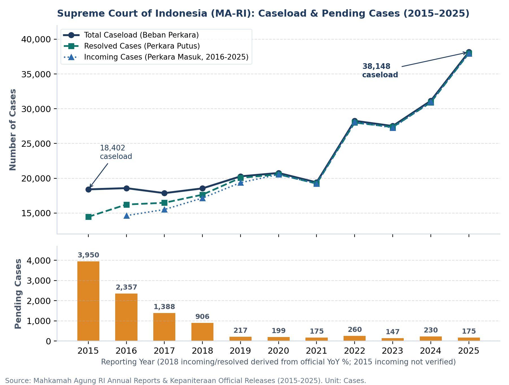
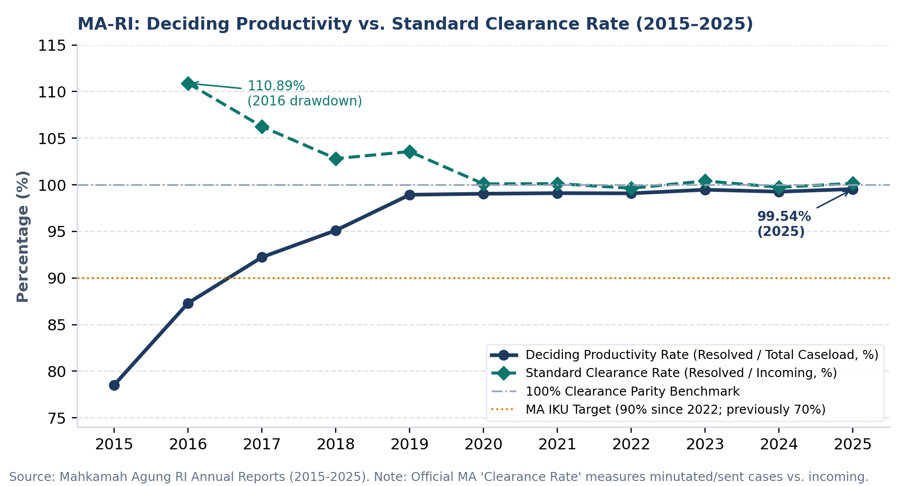
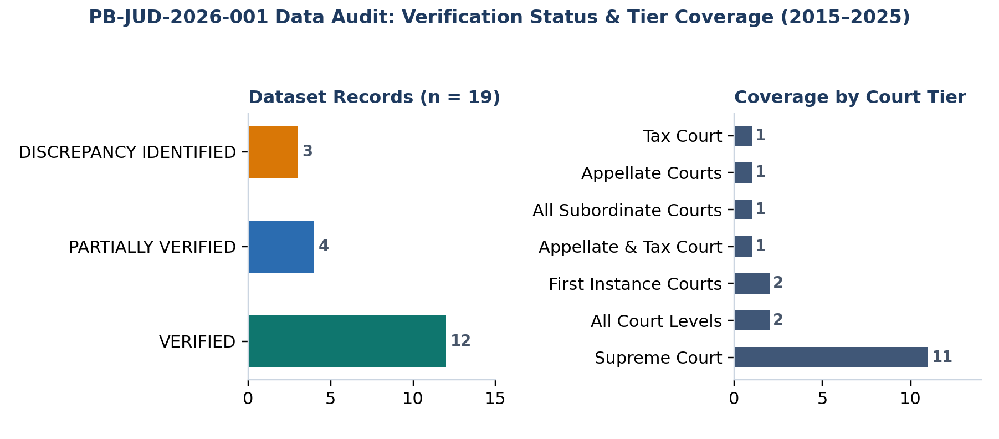

# PB-JUD-2026-001: From Court Statistics to Better Justice Policy
**Subtitle**: Understanding Caseload, Case Clearance, and Pending Cases in Indonesia's Judiciary (2015–2025)  
**Author**: Cecep Mustafa | **Published**: November 25, 2026 | **Version**: `1.0.0`

- [Download Full Policy Brief (PDF)](../../briefs/PB-JUD-2026-001-caseload/policy-brief.pdf)
- [View Dataset (`judicial_caseload.csv`)](../../data/PB-JUD-2026-001/judicial_caseload.csv)
- [View Source Register (`source_register.csv`)](../../data/PB-JUD-2026-001/source_register.csv)
- [View Methodology](../methodology.md)

## Executive Summary
Between 2015 and 2025, the Supreme Court of Indonesia (`MA-RI`) saw its total active caseload more than double (+107.30%, from `18,402` to `38,148` cases), while year-end pending cases fell by **95.57%** (from `3,950` to `175`). Yet headline deciding productivity rates above 99% can obscure metric divergence across court tiers, administrative minutation lags, and minor arithmetic discrepancies in public releases.

## Visualizations

