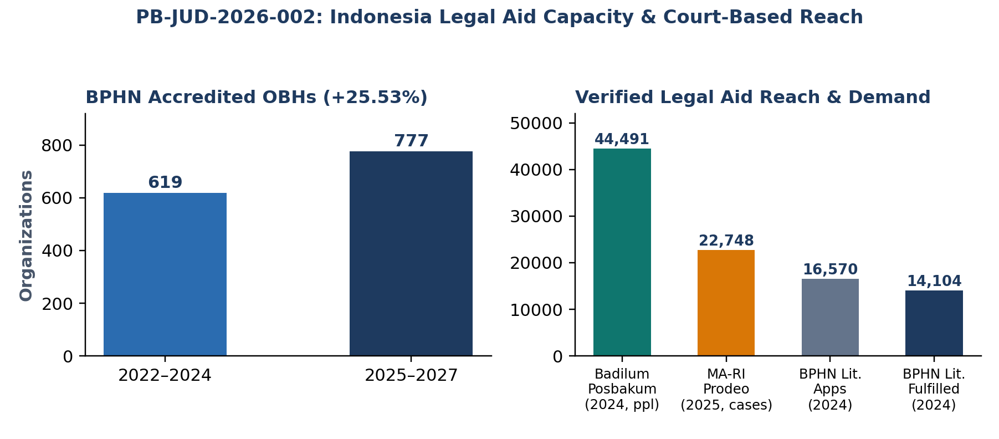

# PB-JUD-2026-002: Measuring Access to Justice and Legal Aid
**Subtitle**: Evaluating Posbakum, Prodeo, and Legal Aid Delivery Across Indonesia  
**Author**: Cecep Mustafa | **Published**: November 26, 2026 | **Version**: `1.0.0`

- [Download Full Policy Brief (PDF)](../../briefs/PB-JUD-2026-002-legal-aid/policy-brief.pdf)
- [View Dataset (`legal_aid_metrics.csv`)](../../data/PB-JUD-2026-002/legal_aid_metrics.csv)
- [View Source Register (`source_register.csv`)](../../data/PB-JUD-2026-002/source_register.csv)

## Key Verified Findings
- **+25.53% OBH Expansion**: BPHN-accredited Legal Aid Organizations rose from `619` (2022–2024) to `777` (2025–2027).
- **85.12% Litigation Fulfillment**: BPHN fulfilled `14,104` of `16,570` `SIDBANKUM` litigation applications in 2024.
- **Court-Based Legal Aid**: General Courts (`Badilum`) served `44,491` Posbakum beneficiaries in 2024; `MA-RI` reached `22,748` Prodeo cases in 2025, though 2025 fiscal efficiency directives triggered temporary local Prodeo suspensions.

