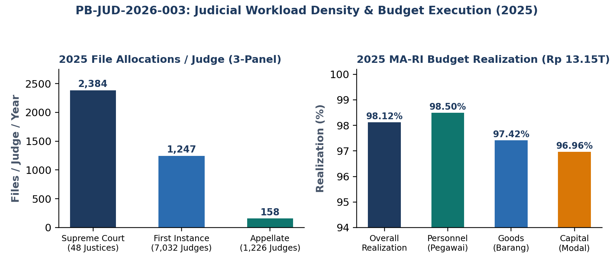

# PB-JUD-2026-003: Judicial Resources and Institutional Capacity
**Subtitle**: Analyzing Judicial Staffing, Budget Allocation, and Caseload Density  
**Author**: Cecep Mustafa | **Published**: November 26, 2026 | **Version**: `1.0.0`

- [Download Full Policy Brief (PDF)](../../briefs/PB-JUD-2026-003-resources/policy-brief.pdf)
- [View Dataset (`judicial_resources.csv`)](../../data/PB-JUD-2026-003/judicial_resources.csv)
- [View Source Register (`source_register.csv`)](../../data/PB-JUD-2026-003/source_register.csv)

## Key Verified Findings
- **3-Judge Panel Workload Density (2025)**: `48` Supreme Court Justices averaged `2,384` file allocations/year; `7,032` First Instance judges averaged `1,247` files/year; `1,226` Appellate judges averaged `158` files/year.
- **Budget Execution**: `MA-RI` budget ceiling rose from `Rp 11.90T` (2024) to `Rp 13.15T` (2025) with `98.12%` realization.

