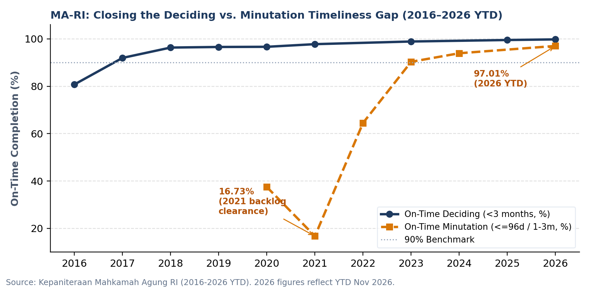

# PB-JUD-2026-004: Court Efficiency, Timeliness, and Case Management
**Subtitle**: Benchmarking On-Time Case Processing and Minutation Turnaround  
**Author**: Cecep Mustafa | **Published**: November 26, 2026 | **Version**: `1.0.0`

- [Download Full Policy Brief (PDF)](../../briefs/PB-JUD-2026-004-timeliness/policy-brief.pdf)
- [View Dataset (`timeliness_metrics.csv`)](../../data/PB-JUD-2026-004/timeliness_metrics.csv)
- [View Source Register (`source_register.csv`)](../../data/PB-JUD-2026-004/source_register.csv)

## Key Verified Findings
- **On-Time Deciding (<3 months)**: Rose from `80.75%` (2016) to `99.52%` (2025) and `99.78%` (2026 YTD).
- **Closing the Minutation Gap**: On-time minutation (`<=96` days / `1–3` months) climbed from `16.73%` (2021) to `64.51%` (2022), `90.32%` (2023), `93.93%` (2024), and `97.01%` (2026 YTD).

