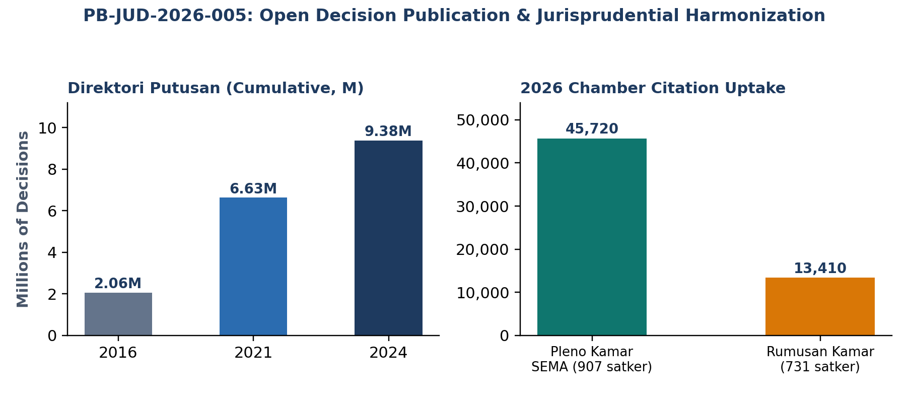

# PB-JUD-2026-005: Judicial Transparency and Public Accountability
**Subtitle**: Evaluating Decision Publication, Chamber Harmonization, and Anti-Bribery Governance  
**Author**: Cecep Mustafa | **Published**: November 26, 2026 | **Version**: `1.0.0`

- [Download Full Policy Brief (PDF)](../../briefs/PB-JUD-2026-005-transparency/policy-brief.pdf)
- [View Dataset (`transparency_metrics.csv`)](../../data/PB-JUD-2026-005/transparency_metrics.csv)
- [View Source Register (`source_register.csv`)](../../data/PB-JUD-2026-005/source_register.csv)

## Key Verified Findings
- **Direktori Putusan Growth**: Published decisions grew from `2,061,320` (2016) to `6,626,144` (2021) and `9,382,440` (2024).
- **Chamber Harmonization**: `576` legal formulations issued (2012–2025), cited across `59,130` decisions (`907` satkers).
- **Digital Accountability**: `99.12%` e-Kasasi/e-PK adoption (2026 YTD), backed by `SMAP`, `SK KMA 15/2025`, and `RESPEK-SIAP` integration.

