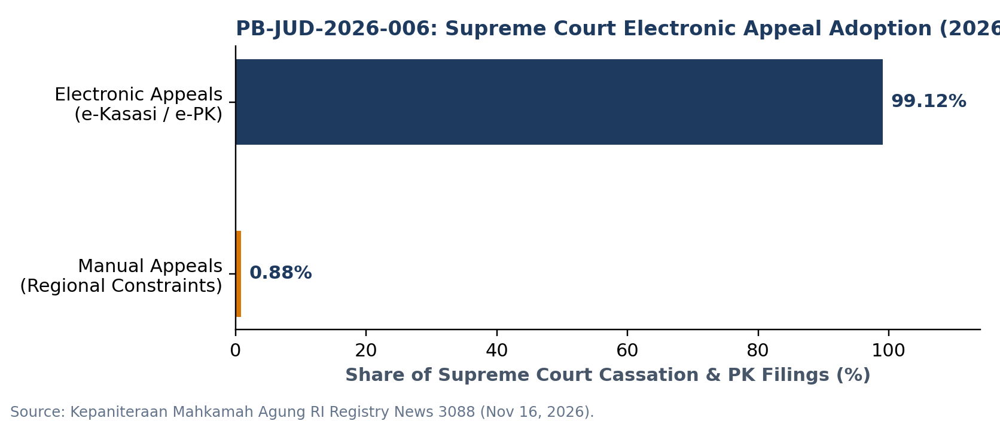

# PB-JUD-2026-006: Digital Justice and Institutional Transformation
**Subtitle**: Evaluating e-Court, e-Berpadu, and Electronic Appeals in Indonesia  
**Author**: Cecep Mustafa | **Published**: November 26, 2026 | **Version**: `1.0.0`

- [Download Full Policy Brief (PDF)](../../briefs/PB-JUD-2026-006-digital-justice/policy-brief.pdf)
- [View Dataset (`digital_justice_milestones.csv`)](../../data/PB-JUD-2026-006/digital_justice_milestones.csv)
- [View Source Register (`source_register.csv`)](../../data/PB-JUD-2026-006/source_register.csv)

## Key Verified Findings
- **Full-Stack Digitalization (2018–2026)**: Evolved from `e-Court` (`PERMA 3/2018`) and `e-Litigation` (`PERMA 1/2019`) to `e-Berpadu` (`PERMA 4/2020`), `e-Kasasi/e-PK` (`PERMA 6/2022`), `e-HUM` (2025), and `e-Tax Court` (2025).
- **99.12% Electronic Appeal Adoption**: By November 2026, `99.12%` of Supreme Court cassation and PK filings were submitted electronically (`0.88%` manual).

